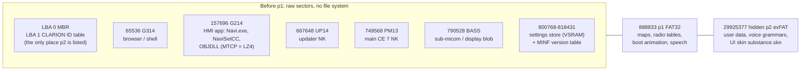
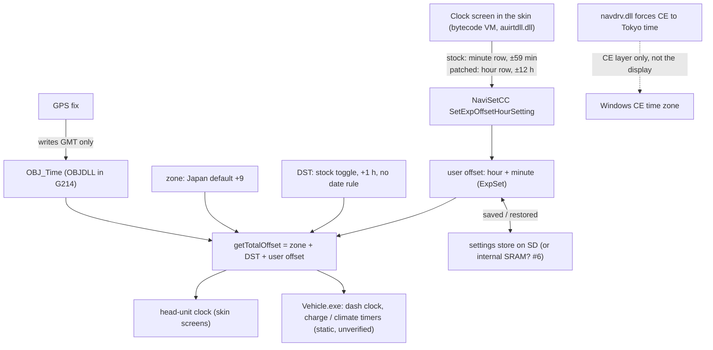

# LEAF Clarion discovery

Notes and read-only tools from taking apart the **Clarion-built factory nav / head unit of a Japanese-market (JDM) Nissan LEAF**: how it works, what is on its SD card, and which tools were used to find out. This is what we saw:

- the **SD card is the unit's main storage**, with a **hidden partition** that a PC never shows;
- the **Windows CE firmware** sits in raw slots before the first partition;
- a **skin** file on the hidden partition drives the whole UI, down to bytecode for every screen;
- the clock runs on Japan time, and the stock firmware has an **unused hour setter**. An 11-byte skin edit calls it, and the clock now shows New Zealand time.

> **Scope: one car, one card.** Everything here comes from a single **30 kWh JDM Nissan LEAF** (owner-stated) with the Clarion nav unit on **firmware 066**: slots `G314JLNI.066` and `G214JLNI.066`, MINF components `G1066`/`G2066`/`G3066`/`S1066`/`S2066` **[confirmed, slot headers and MINF at LBA 800783]**, on the 16 GB map card labelled `485-1972-00`. Other LEAF models, firmware versions and cards may differ in offsets, sizes and behaviour. The tools pin hashes and sizes for this card and refuse anything else.

## System overview

The SD card is not just a map card: it is the unit's main storage. No bootloader is on the card (MINF names `BL102`, so it is probably in the unit's internal flash **[likely]**); the firmware, settings and UI are all on the card **[confirmed]** ([01](docs/findings/01-card-layout-and-firmware.md)).

### What is on the card



| piece | what it is | doc |
|---|---|---|
| SD card layout | MBR with p1 (maps), a `CLARION ID` shadow MBR in sector 1 that adds a hidden exFAT p2, and an unpartitioned area before p1 | [01](docs/findings/01-card-layout-and-firmware.md) |
| Firmware | Windows CE ROM slots before p1: `G314` (browser/shell), `G214` (HMI app, MTCP/LZ4), `UP14` (updater NK), `PM13` (main NK), plus a `BASS` blob | [01](docs/findings/01-card-layout-and-firmware.md), [05](docs/findings/05-ce-rom-extract.md), [06](docs/findings/06-mtcp-lz4.md) |
| Hidden p2 | user data (phonebook, CARWINGS), voice grammars and the UI skin `SkinChange/002/substance.skn` | [01](docs/findings/01-card-layout-and-firmware.md) §6 |
| Skin | a chain of records holding string tables, bytecode for every screen and its handlers, and 7,163 images; the screens call firmware COM objects by DISPID. This card's skin was not stock: it had already been modified (the baseline pins in the code record it), and the hour-row edit sits on top | [11](docs/findings/11-skin-pipeline.md) §1, [12](docs/findings/12-hour-offset-ui.md) §1 |
| Settings store | "virtual SRAM on SD": A/B copies of the sys, nav and bt areas with generation counters and sums | [01](docs/findings/01-card-layout-and-firmware.md), [05](docs/findings/05-checksums.md) |
| p1 data | map DB, radio tables, calendars, certificates, boot animation, speech | [03](docs/findings/03-config-files.md), [04](docs/findings/04-language-speech.md) |
| SoC / OS | Renesas R-Car M1A (ARM Cortex-A9), Windows Embedded Compact 7 | [05](docs/findings/05-ce-rom-extract.md) |

### How the clock is worked out at run time



- **Boot path:** the bootloader in internal flash starts PM13, the main Windows CE 7 image **[likely]**. PM13's AppLaunch loads the G214 HMI app. It compares G214's header on the internal NOR flash with the copy on the SD card and can fall back to the NOR copy; this is the main lead for why patched G214 never took effect **[confirmed static; runtime branch unobserved]** ([08](docs/findings/08-nz-clock-implementation.md) §14.2).
- **UI:** every screen is bytecode in the skin, run by a VM in `auirtdll.dll`. The screens call firmware COM objects (NaviSetCC, NaviGeneralCC, …) by DISPID, so a skin edit can call any firmware function that is exposed but unused **[confirmed]** ([12](docs/findings/12-hour-offset-ui.md) §1).
- **Clock:** the displayed time is GMT plus a Japan zone (+9), DST and a user offset. The Clock screen only ever set the minute part. The hour row now sets the hour part through the stock setter **[confirmed static; owner report for the result]** ([12](docs/findings/12-hour-offset-ui.md) §1.3, §4).
- **Settings store:** A/B copies with generation counters and additive sums. The unit re-saves it, so raw edits get replaced **[confirmed]** ([05](docs/findings/05-checksums.md) §2, [08](docs/findings/08-nz-clock-implementation.md) §13).

## What we have learned

**About the card and firmware**

- The hidden p2 partition appears only in the sector-1 `CLARION ID` table. The real MBR blanks it, so a PC sees no hidden partition **[confirmed]** ([01](docs/findings/01-card-layout-and-firmware.md) §2)
- G214, the HMI app, is **MTCP = raw LZ4 chunks** plus a raw tail, holding 287 CE modules **[confirmed]** ([06](docs/findings/06-mtcp-lz4.md))
- Firmware slots carry **`SUM4`/`NKOK` headers**, and every integrity field found is a **plain additive sum**, never a CRC or signature **[confirmed]** ([05](docs/findings/05-checksums.md))
- The CPU is a Renesas R-Car M1A (ARM Cortex-A9) running Windows Embedded Compact 7 **[confirmed]** ([05](docs/findings/05-ce-rom-extract.md) §3). With the updater slot at byte 0x14600000, that matches leafsdtools' **QY8XXX** unit family **[likely]** ([13](docs/findings/13-prior-art-leafsdtools.md))
- The built-in **holiday table is pre-2019 Japanese** and FM covers **76–90 MHz** only **[confirmed]** ([01](docs/findings/01-card-layout-and-firmware.md), [03](docs/findings/03-config-files.md))

**About the skin**

- The skin isn't only text. Every screen is **bytecode**, and all 10,215 code records decode **[confirmed]** ([12](docs/findings/12-hour-offset-ui.md) §1.1)
- The skin's **trailer value `0x0F6596FD` is no standard checksum**, and the unit doesn't seem to check it: edited skins with the old trailer load fine **[confirmed for same-size builds]** ([11](docs/findings/11-skin-pipeline.md) §1, [12](docs/findings/12-hour-offset-ui.md) §0.2)
- `substance.skn` has a **UTC+11 exFAT timestamp**, so a PC wrote it, not the unit **[likely]** ([01](docs/findings/01-card-layout-and-firmware.md) §6). This card's skin was already modified when we found it.

**About the clock**

- The firmware already has a **±12 h hour setter that no screen calls**. The stock Clock screen only offers ±59 minutes **[confirmed static]** ([06](docs/findings/06-hmi-clock-and-hooks.md) §2, [12](docs/findings/12-hour-offset-ui.md) §1.3)
- **11 same-length bytes in the skin** point the minute row at that setter, and the clock now shows NZ time **[confirmed, owner report]** ([12](docs/findings/12-hour-offset-ui.md) §0)
- The clock has **two separate Japan defaults**: `navdrv.dll` forces CE to Tokyo time, and the app picks UTC+9 on its own. Changing CE alone does nothing for the display **[confirmed static]** ([07](docs/findings/07-nz-clock-design.md) §1)
- **GPS overwrites the manual Set Clock** in the service menu. It seeds UTC, and the antenna puts it back **[confirmed, owner report + static]**. The user offset is a separate, additive value that GPS leaves alone **[likely, static]** ([08](docs/findings/08-nz-clock-implementation.md) §15, [12](docs/findings/12-hour-offset-ui.md) §4.1)

**About working on it**

- **Go up a layer when firmware won't move.** Patched G214 was written and verified several times and never showed an effect; the skin visibly loads from the card, so the fix moved there **[confirmed result, cause open]** ([08](docs/findings/08-nz-clock-implementation.md) §14.2, [12](docs/findings/12-hour-offset-ui.md) §0.6)
- **The unit fights raw edits.** A zone written straight into the settings store came back as Japan/+9 after a drive. Going through the unit's own setter is what sticks **[confirmed, read-back]** ([08](docs/findings/08-nz-clock-implementation.md) §13)
- **Work from an image and pin everything.** All analysis ran on a read-only image. Every write was pinned by SHA256, byte-verified and reversible, which made it cheap to try ideas and back out ([BACKUPS](docs/BACKUPS.md))

## What has worked

- **Patching the minute row into an hour row fixes the clock.** 11 same-length bytes in the skin point the Clock screen's minute row at the firmware's unused hour setter, so its + / − buttons move the clock by whole hours. Set +3 for NZST or +4 for NZDT, and the head-unit clock shows NZ time **[confirmed, owner report]** ([12](docs/findings/12-hour-offset-ui.md) §0, [#1](https://github.com/prasys/nz-leaf-discovery/issues/1))
- **The unit loads edited skins from the card.** Same-size builds with the old trailer load and show in the car **[confirmed]** ([11](docs/findings/11-skin-pipeline.md), [12](docs/findings/12-hour-offset-ui.md) §0.2)
- **Card writes are safe to repeat and undo.** Every write ran through the pinned writers: full-card backup, read-only preflight, owner-run `--apply`, byte-exact read-back, a receipt and a rollback snapshot **[confirmed, receipts]** ([BACKUPS](docs/BACKUPS.md))
- **The card reads end to end without mounting it.** Hidden partition, firmware slots, CE ROM modules, MTCP/LZ4 (checked against `liblz4`), slot checksums and the settings store all decode with the read-only tools **[confirmed]** ([01](docs/findings/01-card-layout-and-firmware.md), [05](docs/findings/05-checksums.md), [06](docs/findings/06-mtcp-lz4.md))
- **The skin's screen code decodes.** All 10,215 bytecode records parse, which is how the hour setter was found **[confirmed]** ([12](docs/findings/12-hour-offset-ui.md) §1)

## In progress

| | state | where |
|---|---|---|
| Automatic NZ DST | The owner switches +3 ↔ +4 by hand twice a year. A manual DST toggle build exists, untested and not written | [12](docs/findings/12-hour-offset-ui.md) §8, [#2](https://github.com/prasys/nz-leaf-discovery/issues/2) |
| Hour row label | Still reads "Minutes" | [#3](https://github.com/prasys/nz-leaf-discovery/issues/3) |
| Dash clock, charge/climate timers, persistence | Vehicle.exe reads the corrected local time [confirmed static]; not yet checked in the car, nor across GPS reconnects and power cycles | [#4](https://github.com/prasys/nz-leaf-discovery/issues/4) |
| Dormant +13 G214 probe | Still on the card from the firmware tests; retire it with a pinned restore | [#5](https://github.com/prasys/nz-leaf-discovery/issues/5), [#8](https://github.com/prasys/nz-leaf-discovery/issues/8) |
| Where the clock setting lives | SD settings store or the unit's internal flash? | [#6](https://github.com/prasys/nz-leaf-discovery/issues/6) |
| Maps, voice, FM, GPS | Research; see To do and Other topics | [#12](https://github.com/prasys/nz-leaf-discovery/issues/12), [#14](https://github.com/prasys/nz-leaf-discovery/issues/14), [#15](https://github.com/prasys/nz-leaf-discovery/issues/15), [#16](https://github.com/prasys/nz-leaf-discovery/issues/16) |

**Try it on your own card:** read [docs/BACKUPS.md](docs/BACKUPS.md) first, then follow [12 §0.5](docs/findings/12-hour-offset-ui.md#05-repeat-or-roll-back-owner-runs---apply). You need a full-card backup, a build that matches a pinned SHA256, and a read-only preflight that passes. If your card differs from this one, the writer refuses, and that is on purpose.

## What didn't work

Firmware-level attempts were all written and byte-verified on the card, and the car showed **no change** each time **[confirmed, owner report]**. Details, likely reasons and receipts are in [12 §0.6](docs/findings/12-hour-offset-ui.md#06-what-didnt-work-and-why-the-fix-moved-to-the-skin) and [08](docs/findings/08-nz-clock-implementation.md).

- **NZ-clock payload in G214/OBJDLL** (rebuilt, repacked slot): no change. The patched module probably never ran **[likely]**
- **Fixed +13 probe in G214**: no change. It is **still on the card, dormant**; retiring it is [#5](https://github.com/prasys/nz-leaf-discovery/issues/5)
- **Saved zone set to +13 in the settings store**: the unit rewrote it back to Japan/+9 **[confirmed, read-back]**
- **Widening the minute range** to ±3–4 h: not built. NaviSetCC caps the minute setter at ±59, so it would need the same G214 patching that never took effect

That is why the fix moved up a layer: the skin visibly loads from the card, and the firmware's own unused hour setter was one skin edit away. Every write left a receipt and a rollback snapshot, and the full backup predates them all ([BACKUPS](docs/BACKUPS.md)).

## To do

- **Japanese maps:** understand the `DBDIR` map database well enough to say whether NZ maps can go on this unit ([#12](https://github.com/prasys/nz-leaf-discovery/issues/12), [#13](https://github.com/prasys/nz-leaf-discovery/issues/13); the detailed map-format drafts are not public yet)
- **Voice guidance:** identify the GID prompt codec ([#14](https://github.com/prasys/nz-leaf-discovery/issues/14)) and see whether the prompts can be mapped or replaced
- **Clock follow-ups:** automatic NZ DST ([#2](https://github.com/prasys/nz-leaf-discovery/issues/2)), the "Minutes" label ([#3](https://github.com/prasys/nz-leaf-discovery/issues/3)), car validation of dash, timers and persistence ([#4](https://github.com/prasys/nz-leaf-discovery/issues/4)), retiring the dormant G214 probe ([#5](https://github.com/prasys/nz-leaf-discovery/issues/5))
- Smaller open items: which store holds the clock setting ([#6](https://github.com/prasys/nz-leaf-discovery/issues/6)), the unit's model code ([#7](https://github.com/prasys/nz-leaf-discovery/issues/7)), pinned restore writers ([#8](https://github.com/prasys/nz-leaf-discovery/issues/8))

## Other topics

| topic | what is known | where |
|---|---|---|
| Maps (NZ) | The JP map DB is a paged RDBMS (`DBDIR`) keyed on unsigned JIS mesh cells, not osm2clarion's EU tiles. BPCL drawing records decode end to end and match OSM coastline within metres. NZ needs at least a signed-latitude change in firmware [likely] | [#12](https://github.com/prasys/nz-leaf-discovery/issues/12), [#13](https://github.com/prasys/nz-leaf-discovery/issues/13) |
| FM band | Tables cover 76–90 MHz, no checksum. Whether the tuner reaches 88–108 MHz is open | [03](docs/findings/03-config-files.md), [#15](https://github.com/prasys/nz-leaf-discovery/issues/15) |
| GPS latitude shown as North | The owner sees "N" next to the NZ latitude. Property names found in G214; cause open | [#16](https://github.com/prasys/nz-leaf-discovery/issues/16), [08](docs/findings/08-nz-clock-implementation.md) §14.6 |
| Boot logo | `BASS` container with a u32 word-sum, on p1 and in slot 790528. Payload not decoded | [03](docs/findings/03-config-files.md) §10, [#17](https://github.com/prasys/nz-leaf-discovery/issues/17) |
| Voice prompts | Japanese Nuance TTS/VoCon. Recorded guidance clips use an unidentified codec | [04](docs/findings/04-language-speech.md), [#14](https://github.com/prasys/nz-leaf-discovery/issues/14) |
| Card binding | Unknown. Keyed blobs at LBA 800768–800772; clone boot untested. The card is not SD-password-locked | [#10](https://github.com/prasys/nz-leaf-discovery/issues/10), [#9](https://github.com/prasys/nz-leaf-discovery/issues/9), [13](docs/findings/13-prior-art-leafsdtools.md) §2.4 |
| Checksums | All additive sums. Open: G214 header +0x14, MTLD +0x08, NK +0x6C | [05](docs/findings/05-checksums.md), [#11](https://github.com/prasys/nz-leaf-discovery/issues/11) |

## Tools used

- **Python 3 stdlib parsers** in `tools/`, run with `python3 -I` against the image opened read-only
- **Our own disk parsers** for MBR, `CLARION ID`, FAT32 and exFAT, so the hidden partition never gets mounted
- **CE ROM tools**: ROMHDR/e32/o32 extractor, LZX "CECompress", MTCP/LZ4 unpacker, registry hive reader
- **Ghidra headless** (`ARM:LE:32:v7`) with small Java/Python scripts for the decompiler traces
- **Skin tools**: container decoder, bytecode decoder, hour-row builder, COM typelib/DISPID lister
- **Read-only imaging and pinned card writers** (`image_card.py`, `backup_card.py`, `write_skin.py`): preflight by default, the owner applies ([BACKUPS](docs/BACKUPS.md))
- **AI agents**: Claude Code, Codex and opencode, one GitHub issue per branch, each in its own Orca worktree

**Working on this with an agent?** Point your agent (Claude Code, Codex, opencode, …) at [`AGENTS.md`](AGENTS.md) / `CLAUDE.md`. It has the rules and paths to figure out the rest.

| `tools/` folder | what it holds |
|---|---|
| `raw-areas/` | MBR, exFAT walker, ROMHDR lister, magic/UTF-16 scanners ([01](docs/findings/01-card-layout-and-firmware.md)) |
| `unit-and-clock/` | early string and Shift-JIS scanners ([02](docs/findings/02-unit-and-clock.md)) |
| `config-files/` | FAT directory reader, radio tables, checksum candidates ([03](docs/findings/03-config-files.md)) |
| `language-speech/` | speech container parser and TTS/GID/grammar extractors ([04](docs/findings/04-language-speech.md)) |
| `checksums/` | slot SUM4/sum8 and VSRAM SRST/SRED verifiers ([05](docs/findings/05-checksums.md)) |
| `ce-extract/` | CE ROM extractor, LZX, MTCP unpacker, hive reader ([05](docs/findings/05-ce-rom-extract.md)) |
| `mtcp/` | verified LZ4 decoder and G214 module inventory ([06](docs/findings/06-mtcp-lz4.md)) |
| `hmi-skin/` | COM typelib / DISPID lister |
| `clock-analysis/` | Ghidra scripts from the clock traces ([07](docs/findings/07-nz-clock-design.md), [08](docs/findings/08-nz-clock-implementation.md)) |
| `nz-clock/` | `image_card.py` (read-only imaging), `backup_card.py`, the G214 writer and the historical ARM candidate ([08](docs/findings/08-nz-clock-implementation.md)) |
| `translation/` | skin container reader and the pinned `write_skin.py` card writer ([11](docs/findings/11-skin-pipeline.md)) |
| `hour-offset-ui/` | skin bytecode decoder, hour-row build, ExpSet read-back ([12](docs/findings/12-hour-offset-ui.md)) |

## Docs

- [docs/BACKUPS.md](docs/BACKUPS.md): imaging, backups, writing and rollback
- [AGENTS.md](AGENTS.md): rules for agents (and a good summary of the house rules for people)

Findings in [`docs/findings/`](docs/findings), by file number. 05 and 06 are each used twice; the files keep their names so links stay valid.

- [01](docs/findings/01-card-layout-and-firmware.md) Card layout & firmware slots
- [02](docs/findings/02-unit-and-clock.md) Unit identity & clock: early survey (superseded for the clock by 12)
- [03](docs/findings/03-config-files.md) Config files on p1
- [04](docs/findings/04-language-speech.md) Language & speech
- [05](docs/findings/05-checksums.md) Checksums · [05](docs/findings/05-ce-rom-extract.md) CE ROM extraction & CPU
- [06](docs/findings/06-mtcp-lz4.md) G214 MTCP/LZ4 · [06](docs/findings/06-hmi-clock-and-hooks.md) HMI clock & file hooks
- [07](docs/findings/07-nz-clock-design.md) NZ clock design review (design only)
- [08](docs/findings/08-nz-clock-implementation.md) NZ clock firmware experiments (no effect; history)
- [11](docs/findings/11-skin-pipeline.md) Skin container format and `write_skin.py`
- [12](docs/findings/12-hour-offset-ui.md) **Working hour offset**: overview, assumptions, procedure, evidence
- [13](docs/findings/13-prior-art-leafsdtools.md) Prior art: leafsdtools

## Related projects

- **Maps:** [albertbm/osm2clarion](https://github.com/albertbm/osm2clarion) builds OpenStreetMap maps for European Clarion QY8x cards. We compared it with the JP `DBDIR` format; it isn't a drop-in, and a JP-target fork is in progress ([#12](https://github.com/prasys/nz-leaf-discovery/issues/12), [#13](https://github.com/prasys/nz-leaf-discovery/issues/13))
- **SD card / unit:** [developerfromjokela/leafsdtools](https://github.com/developerfromjokela/leafsdtools) is an on-unit Windows CE tool for NAND backup, PROD/IMMO and SD lock. Its card builder patches the same updater slot as our UP14, and its NK checksum rule matches our slots ([13](docs/findings/13-prior-art-leafsdtools.md))
- **WinCE ROM:** [pinkavaj/romtools](https://github.com/pinkavaj/romtools) (`dumprom`) is a WinCE ROM dumper. We use it as the reference for CE ROM section flags such as `IMAGE_SCN_COMPRESSED` ([06-mtcp](docs/findings/06-mtcp-lz4.md) §5)
- **MTCP/LZ4:** [lz4/lz4](https://github.com/lz4/lz4): G214's MTCP chunks are raw LZ4 blocks, checked byte-for-byte against upstream liblz4 ([06-mtcp](docs/findings/06-mtcp-lz4.md))

## Layout and safety

```
docs/BACKUPS.md        how to write safely
docs/findings/         findings per topic
tools/<topic>/         read-only parsers, plus the pinned writers
binaries/MANIFEST.md   sha256 of every out-of-tree binary we reference
```

**Binaries are never committed.** The firmware is Clarion/Nissan copyright, and the card holds personal data (phonebooks, paired phones, location history). Keep your copies under `$NISSAN_ROOT` (default `~/nissan`): `sdcard/<image>.img` and `work/<topic>/`. Tools read `NISSAN_IMG` (default `~/nissan/sdcard/nissan-sd-485-1972-00.img`).

- **Never write to the original image.** Image the card once, before Finder mounts it, then work from the image read-only ([BACKUPS §1](docs/BACKUPS.md#1-image-the-card-read-only-owner)).
- Make a verified full-card backup before any write, and use only the pinned writers.
- Whether a cloned card boots is untested ([#9](https://github.com/prasys/nz-leaf-discovery/issues/9)). The owner chose to write the production card after a verified backup ([08](docs/findings/08-nz-clock-implementation.md) §5).
- Don't edit VSRAM or firmware slots by hand. An earlier raw edit of the saved zone was simply replaced by the unit (08 §13).
